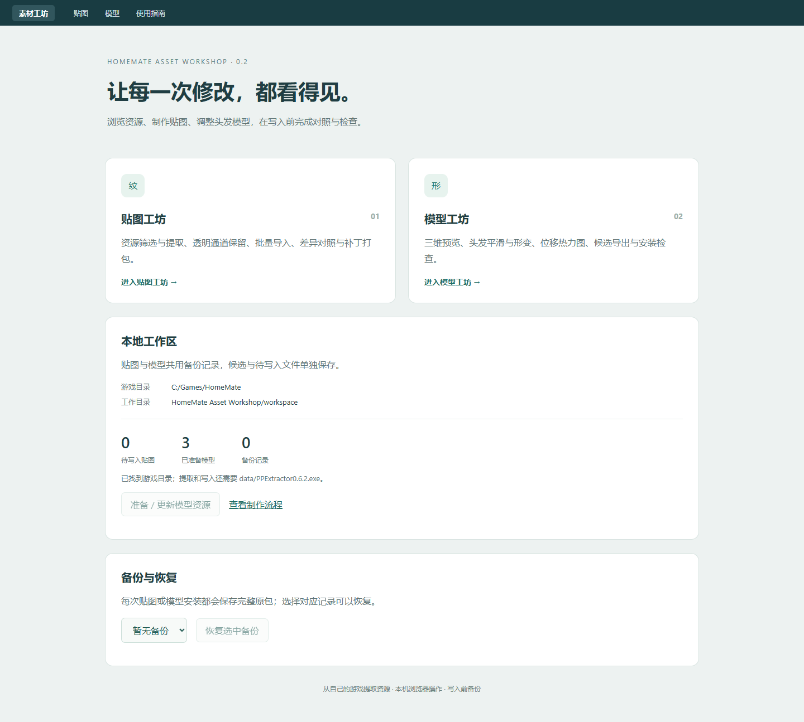

# 御宅伴侣素材工坊

**HomeMate Asset Workshop** 是一个在本机浏览器中使用的《御宅伴侣》素材编辑工具：提取与替换贴图、预览和微调头发模型，并提供候选检查、备份与恢复。

[English](README.en.md) · [功能清单](docs/FEATURES.md) · [使用流程](docs/WORKFLOWS.md) · [开发说明](docs/DEVELOPMENT.md) · [更新记录](CHANGELOG.md)

项目源码采用 [MIT License](LICENSE)。普通使用者推荐选择 Windows 便携版。

工具源码与游戏素材分开。仓库和源码发布包不包含游戏、原始贴图、模型、资源包、个人工作区或第三方解包器。首次运行从使用者自己的游戏目录读取资源。



## 功能

| 模块 | 功能 |
| --- | --- |
| 统一首页 | 本地环境检查、工作区概览、模型资源准备、跨模块导航、统一备份恢复 |
| 贴图 | PP/XX 资源浏览、名称和分辨率筛选、PNG/原格式提取、单张和批量导入、透明通道保留、原图/待写入/拖动对照/差异图、缩放、2× 插值样品 |
| 补丁 | 待写入清单、按资源包哈希校验的贴图 ZIP、补丁载入、完整原包备份、恢复 |
| 模型 | XX v2 三维预览、贴图/素模/线框/位移热力图、正侧背视角、部件显示、平滑/膨胀/收缩、指定头发网格、位移限制、候选报告和 XX 导出 |
| 模型安装 | 当前游戏模型检查、受保护字段校验、原生编码解码往返、只替换所选候选、统一备份恢复 |
| 批处理 | 推荐轻度平滑候选集、三视图对比图、ComfyUI PNG 转换/Alpha 合成模板 |

模型几何编辑仅针对已验证的 **XX v2 头发网格**，保持脸部、面索引、UV、权重、骨骼、材质和内嵌贴图。贴图解析器含其他 XX 版本的字段布局，兼容性仍需按具体资源实测。当前不是通用建模器，也没有动画编辑或 PBR 着色器替换功能。

## Windows 便携版：推荐普通使用者选择

运行环境目标为 Windows 10/11 x64，已在 Windows 11 验证。便携版自带 Python、Pillow、NumPy 和原生启动窗口，无需安装 Python、执行 pip 或手改配置文件。编辑页面在默认浏览器中打开。

1. 在仓库 Releases 下载名称包含 **windows-x64-portable.zip** 的文件，完整解压到可写目录。
2. 双击 **素材工坊.exe**，保留旁边的 `_internal` 文件夹。
3. 选择自己的游戏根目录（包含 `data/*.pp`），也可以直接选择 `data` 目录。
4. 启动器自动查找 `data/PPExtractor0.6.2.exe`；没有找到时，选择自己准备的同名解包工具。
5. 点击“启动并打开工坊”。选择会自动保存，下次双击即可打开。

设置、缓存、候选、导出、备份与日志保存在 EXE 同级 `userdata`。目录不可写时使用用户本地应用数据目录，实际位置会显示在启动窗口。浏览器关闭后可以重新打开页面；关闭启动窗口会等待任务完成后停止服务。

更新时关闭旧工坊，将新版解压到新目录，再把旧 `userdata` 完整复制到新 EXE 旁边。不要删除备份。详见 [便携版使用说明](docs/PORTABLE.md) 和 [构建与检查](docs/PACKAGING.md)。

**需要自行准备：** 自己的游戏，以及 `PPExtractor0.6.2.exe`。便携版不包含或自动下载这些外部资源。

## 源码运行环境

- Windows 10/11 与 Python 3.10+。
- Python 依赖：Pillow、NumPy。
- 自己的 HomeMate 游戏目录，内有 `data/*.pp`。
- 提取与写入需要使用者自行准备的 `data/PPExtractor0.6.2.exe`。工具调用其 `/AHM /noretro` 模式，不随本项目分发。
- 无游戏资源也能启动首页与使用指南。跨平台自动测试使用程序生成的小型样本；真实资源提取/安装以 Windows 环境为支持范围。

## 从源码开始使用

可以把项目放在游戏根目录下，也可放到任意路径后配置 `game_dir`。

```powershell
python -m pip install -r requirements.txt
Copy-Item config.example.json config.local.json
```

编辑 `config.local.json`：

```json
{
  "game_dir": "C:/Games/HomeMate",
  "workspace": "workspace",
  "port": 8765
}
```

相对路径以配置文件所在目录为基准；不提供配置文件时，源码运行以项目根目录为基准，wheel 安装运行则以当前目录为基准。`game_dir` 默认 `..`，适合“游戏目录/素材工坊”的布局。命令行 `--game-dir`、`--workspace`、`--port` 覆盖配置；`HM_GAME_DIR` 可在未配置目录时提供游戏路径。

双击 **启动素材工坊.cmd**。默认从本机端口 8765 开始查找空闲端口，首页给出最终地址。贴图工坊与模型工坊在同一服务中运行，不需要分别启动。

关闭后台服务使用 **停止素材工坊.cmd**。也可以在终端前台运行：

```powershell
python run.py --game-dir "C:/Games/HomeMate"
python run.py serve --no-browser --port 8791
python run.py stop
```

启动脚本优先使用项目 `.venv/Scripts/python.exe`，否则使用 PATH 中的 Python。创建虚拟环境后可执行 `.venv/Scripts/python.exe -m pip install -r requirements.txt`。服务只绑定 `127.0.0.1`，写操作使用本地会话令牌。

## 制作流程

**贴图：** 选择资源包 → 筛选和提取 → 重绘 → 导入到待写入区 → 查看对照与 Alpha → 退出游戏 → 备份并写入。

批量导入使用导出目录中的 `texture-manifest.json`。默认导入时恢复原透明通道，新图片须保持原宽高比和 UV 布局。需要导出合回 Alpha 的 PNG 时，切换“待写入”再导出。2× 采样使用插值与锐化，不是 AI 重绘。

**模型：** 首页“准备 / 更新模型资源” → 选择刘海或后发 → 设置操作与目标网格 → 生成候选 → 查看位移热力和原版轮廓 → 导出或安装前检查 → 退出游戏 → 备份并安装当前候选。

原版指本次准备时从**当前游戏**提取的模型，可能已经包含用户之前安装的修改。准备资源不会自动恢复旧补丁。候选生成不会写游戏资源包。安装时会重新比较当前游戏中的模型；若缓存过期，重新准备并生成候选。贴图与模型修改同一资源包时，应先处理完当前待写入贴图，再准备并安装模型。

首页的“备份与恢复”和贴图页面的“恢复备份”共用记录。连续多次安装按倒序恢复；外部修改导致资源包哈希不匹配时拒绝覆盖。工具检查通过后，仍需在游戏中确认动画、穿插、透明边缘与外观。

## 命令行批处理

以下操作使用与网页相同的配置和工作区；批处理时先停止网页服务，避免两个进程同时写同一工作区。

```powershell
python run.py prepare-models
python run.py recommended
python run.py render-comparison
python run.py render-comparison --candidate CANDIDATE_ID
python run.py install-models --candidate CANDIDATE_ID
```

`recommended` 生成或复用当前原模型的轻度平滑候选，保存 `workspace/models/recommended.json`。`render-comparison` 输出原版/候选的正、侧、背对比图。`install-models` 是明确的写入操作；可重复指定 `--candidate`，同一模型只能选择一个候选。恢复使用网页入口。

## 工作区与旧项目

```text
homemate_workshop/      Python 后端、页面、第三方前端库、ComfyUI 模板
tests/                 生成样本的自动测试；integration/ 为本地可选测试
docs/                  功能、流程、架构与迁移说明
tools/                 源码发布包打包工具
workspace/             运行后生成，Git 忽略
  textures/            cache、staged、exports、backups、work
  models/              assets、candidates、reports、recommended.json
config.local.json      本机路径，Git 忽略
```

合并后的工具使用独立工作区，原贴图工坊、模型工坊、头发预览及其待写入内容和备份保留在原位置。旧备份继续由旧工具恢复；新工具不自动迁移安装状态。详见 [迁移说明](docs/MIGRATION.md)。

## 开发验证与源码打包

```powershell
python -m unittest discover -s tests -v
python tools/package_release.py
```

测试不需要上传游戏资源。发布脚本按白名单打包源码、页面、测试、模板和文档，并生成 SHA256；工作区、个人配置、游戏数据、日志、缓存、原生工具和 `.git` 不进入 ZIP。将**此项目目录**作为 GitHub 仓库根目录，而不是整个游戏目录。

从源码也可以执行 `python portable_entry.py` 打开图形启动器。构建 Windows 便携版使用独立的 64 位 Windows Python 环境，安装 `requirements-build.txt` 后运行 `python tools/build_portable.py`。

## 许可与第三方资源

本项目源码采用 **MIT License**，见 [LICENSE](LICENSE)。第三方前端库和运行库保留各自许可证，见 [THIRD_PARTY_NOTICES.md](THIRD_PARTY_NOTICES.md)；便携包附带相应声明。

MIT 许可不代替游戏素材或外部解包器的授权。自行制作的补丁与重绘素材和工具源码分别发布，并记录来源和作者。反馈问题时提供工具版本、重现步骤和脱敏日志即可，无需上传完整游戏或备份。
